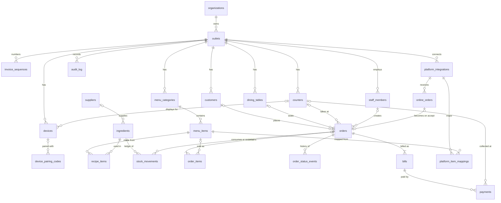
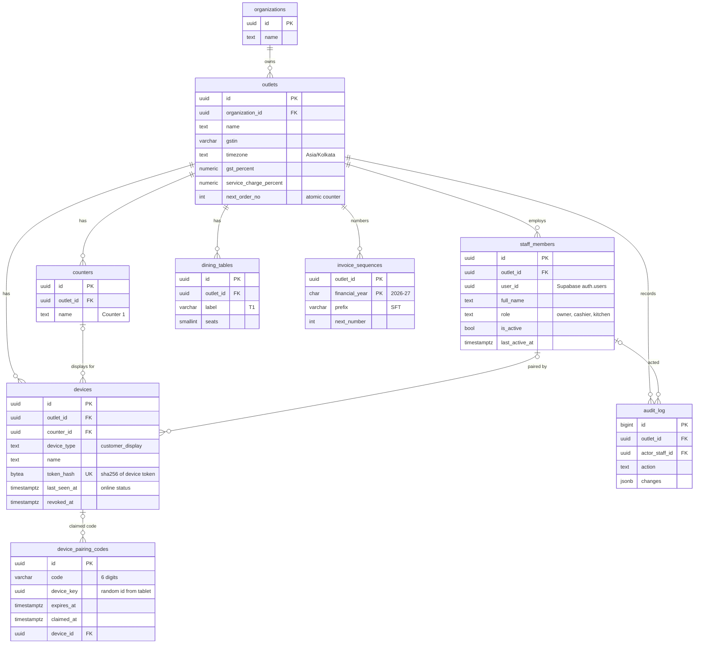
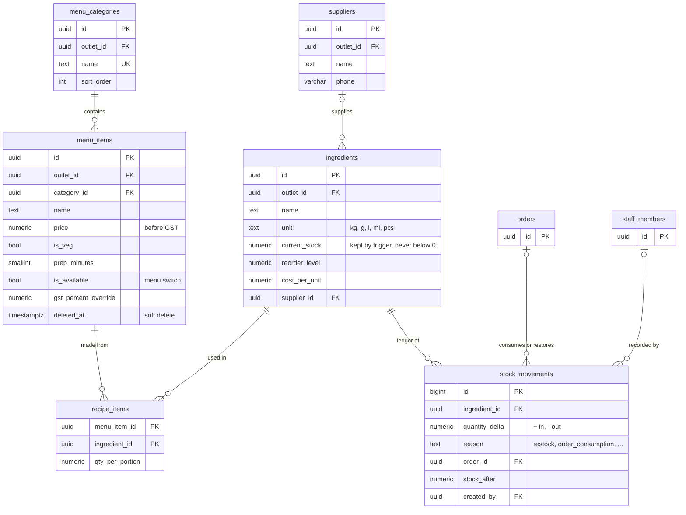
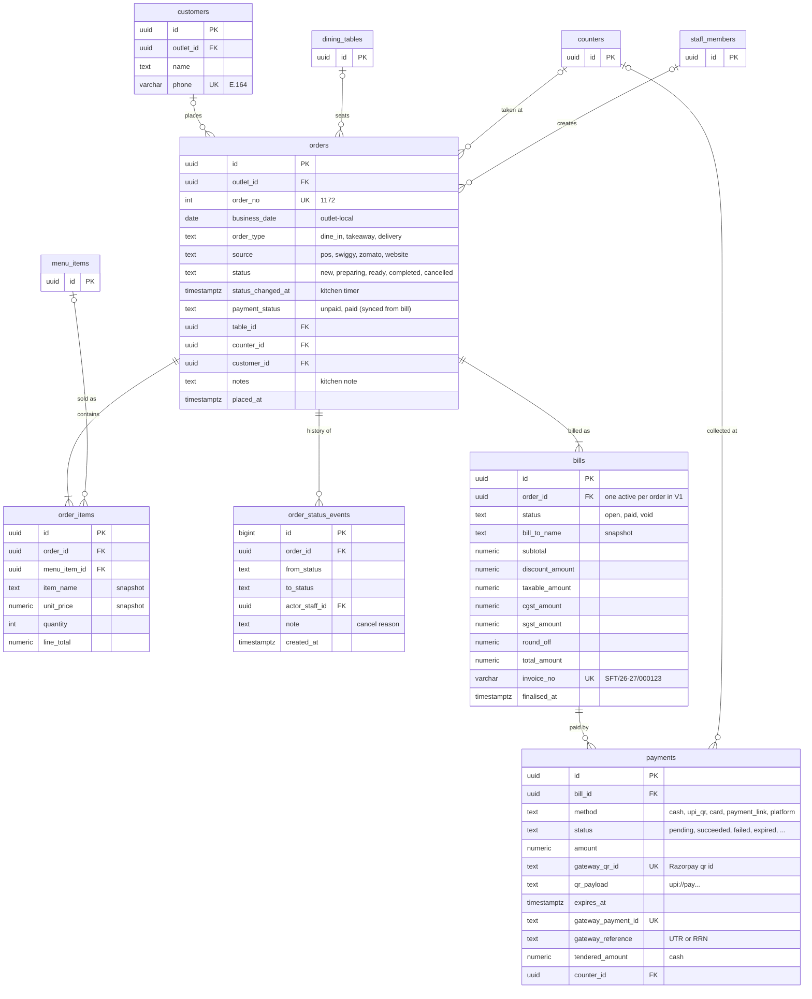
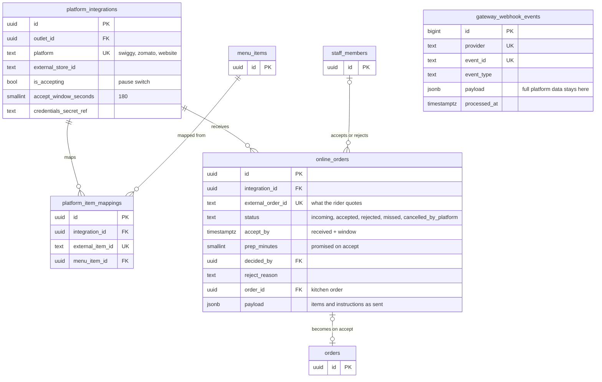

# Tablewise POS: engineering handoff (data model, backend, frontend, deployment)

This folder hands the Tablewise prototype to engineering. It holds the PostgreSQL schema behind every screen (dashboard, POS, orders board, online orders, payments with a customer display, menu, inventory, customers, reports, admin and devices), how the tables relate, the business rules the Spring Boot backend must enforce, and how the two repositories (Vue frontend, Spring Boot backend) are built and deployed (section 12).

The schema is a ready-to-run Flyway migration. It was tested on PostgreSQL 16 against 27 checks covering stock, bills and payments, status history, online orders, devices, numbering and the report views.

## 1. How to use this folder with Claude Code

```
tablewise-backend-handoff/
  README.md                         ← this guide
  prototype/tablewise-prototype.html  ← the clickable prototype (source of truth for screens and behaviour)
  db/migration/V1__init_schema.sql  ← full Postgres schema (tested on PostgreSQL 16)
  db/migration/V2__link_supabase_auth.sql
  docs/er/*.mmd                     ← ER diagrams (Mermaid)
```

The app is two repositories, built and deployed separately (details in section 12):

| Repository | What | Deploys to |
|---|---|---|
| `tablewise-api` | Spring Boot backend: REST API, WebSockets, schedulers, webhooks. Owns `db/migration` | Render (Docker), Singapore region |
| `tablewise-web` | Vue 3 single-page app built from the prototype, including the customer display at `/display` | Vercel |
| (managed) | PostgreSQL | Supabase, Mumbai region |

Suggested first prompt for Claude Code, **backend repo**:

> Build the Spring Boot backend for the restaurant POS in this folder. `prototype/tablewise-prototype.html` shows every screen and rule; `README.md` is the data model, business rules and deployment plan; `db/migration` holds the Flyway migrations, so use them as-is and set Hibernate to `validate`. Follow section 11 (build order) one milestone at a time, with Testcontainers tests for each rule in section 7, and make it deployable to Render as described in section 12.

Suggested first prompt for Claude Code, **frontend repo**:

> Build the Vue 3 + Vite frontend for the restaurant POS. Recreate every screen in `prototype/tablewise-prototype.html` (same layout, wording, roles and states) as Vue components, replacing its in-browser sample data with calls to the backend API and WebSocket channels described in `README.md` sections 6, 8 and 12. Deploy to Vercel as described in section 12.

**Backend stack:** Java 21, Spring Boot 3.3+, Spring Web, Spring Data JPA, Flyway, Spring Security (OAuth2 resource server for Supabase JWTs), Spring WebSocket (STOMP), Spring Boot Actuator, Testcontainers (PostgreSQL), Supabase Postgres.

**Frontend stack:** Vue 3 (Composition API, `<script setup>`), Vite, Vue Router, Pinia, `@stomp/stompjs` for WebSockets, `@supabase/supabase-js` (Auth only), TypeScript recommended.

## 2. Conventions

| Topic | Decision | Why |
|---|---|---|
| Schema | Everything in `pos`, not `public` | Supabase auto-exposes `public` over REST; Spring Boot should be the only way in |
| Keys | `uuid` (`gen_random_uuid()`); append-only logs use `bigint identity` | Safe to generate anywhere, no guessable ids |
| Tenancy | Every outlet-scoped table has `outlet_id`; `organizations → outlets` | One outlet today, chains later without a migration |
| Enums | `text` + `CHECK` | Easy to extend; maps to `@Enumerated(EnumType.STRING)` |
| Money | `numeric(12,2)` → `BigDecimal`; stock `numeric(12,3)` | No float rounding in bills or stock |
| Time | `timestamptz` everywhere; `orders.business_date` = outlet-local date | Reports group by the restaurant's day, not UTC |
| History | Order lines copy item name, price and veg flag; bills copy the customer name | Old bills never change when the menu changes |
| Narrow orders | `orders` holds only what the floor and kitchen need. Money is in `bills`, status times and cancel reasons in `order_status_events` | The live boards read a small, hot table; finance has its own record |
| Growth | Reports read `business_date`-indexed views. At scale: a nightly summary table, then monthly partitions of `orders` and `order_items` by `business_date` | Row volume is handled by indexing and partitioning, not by more columns |
| Platform data | Swiggy and Zomato own delivery, customer and rider data. We keep the accept or reject decision, the kitchen order and the platform order id; the full payload stays in `gateway_webhook_events` | Less to sync, less personal data to hold |
| Deletes | Menu items and ingredients soft-delete (`deleted_at`); categories and recipe ingredients are RESTRICT | Matches the prototype ("move dishes first", "remove from recipes first") |
| Ledgers | `stock_movements`, `order_status_events`, `gateway_webhook_events`, `audit_log` are append-only | Full audit trail; stock is derived from the ledger |
| Stock | A trigger applies each `stock_movements` row to `ingredients.current_stock`; `CHECK (current_stock >= 0)` | The database itself refuses to oversell |
| Security | RLS enabled on every table with no policies | Supabase anon/authenticated roles see nothing; Spring connects as owner |

## 3. Tables by domain

**Tenancy, staff, floor, devices**

| Table | Purpose | Screens |
|---|---|---|
| `organizations` | Company or brand that owns outlets | Admin |
| `outlets` | Restaurant location; GSTIN, GST %, service charge, timezone, `next_order_no` | Admin > Restaurant and billing |
| `staff_members` | People and their role (`owner`, `cashier`, `kitchen`); `user_id` links to Supabase Auth | Admin > Staff, role switcher |
| `counters` | Billing terminals ("Counter 1") | "This terminal", payments, displays |
| `dining_tables` | Tables for dine-in ("T1") | New order table picker |
| `devices` | Paired screens (customer display), token hash, last seen | Admin > Customer displays |
| `device_pairing_codes` | 6-digit codes shown on unpaired tablets | Customer display pairing |
| `invoice_sequences` | Consecutive GST invoice numbers per financial year | Billing |
| `audit_log` | Who changed prices, settings, staff, devices | Admin (future screen) |

**Menu and inventory**

| Table | Purpose | Screens |
|---|---|---|
| `menu_categories` | Starters, Mains… | Menu, POS chips, Admin > Categories |
| `menu_items` | Dish, price before GST, veg flag, prep time, on/off switch | Menu, POS |
| `recipe_items` | Ingredient quantity per portion of a dish | Dish form, stock deduction, availability |
| `ingredients` | Raw material, unit, current stock, reorder level, cost | Inventory |
| `suppliers` | Who supplies an ingredient | Inventory |
| `stock_movements` | Ledger: opening stock, restock, order consumption, cancellation, correction, wastage | Inventory > Movement log |

**Customers, orders, payments**

| Table | Purpose | Screens |
|---|---|---|
| `customers` | Name and phone, unique phone per outlet | Customers, POS customer fields |
| `orders` | What the floor and kitchen work on: number, type, source, status, paid flag, table, counter, customer, note (17 columns) | POS, Orders board, search, Dashboard |
| `order_items` | Lines with snapshots | Board cards, bill, reports |
| `order_status_events` | Every status change with actor, time and note (cancel reason) | "Preparing for 9 min", cancel details, audit |
| `bills` | Financial record of an order: subtotal, discount, service charge, GST split, round-off, total, invoice number. One active bill per order in V1; split bills later add more | Collect payment, invoices, Reports |
| `payments` | Each payment attempt against a bill: cash, UPI QR, card, link, platform | Collect payment, customer display, reports |
| `gateway_webhook_events` | Raw webhooks, idempotent by `(provider, event_id)` | Background |

**Online orders**

| Table | Purpose | Screens |
|---|---|---|
| `platform_integrations` | Swiggy / Zomato / website per outlet, pause switch, accept window | Online orders > platform switches |
| `platform_item_mappings` | Platform item id → our `menu_items` | Setup |
| `online_orders` | Inbox of platform orders: platform order id, accept deadline, decision (accepted, rejected, missed, cancelled by platform), promised prep time, link to the kitchen `orders` row, payload as sent | Online orders tabs |

**Read views** (in the migration): `v_menu_availability`, `v_ingredient_status`, `v_table_occupancy`, `v_order_timeline` (status times and cancel details from the event log), `v_daily_sales`, `v_item_sales`, `v_payment_mode_daily`, `v_customer_stats`.

## 4. Relationships

| From | To | Cardinality | Notes |
|---|---|---|---|
| organizations | outlets | 1 → many | |
| outlets | staff_members, counters, dining_tables, devices, menu_categories, ingredients, suppliers, customers, orders, platform_integrations | 1 → many | `outlet_id` on each |
| counters | devices | 0..1 → many | A display shows one counter's payments |
| devices | device_pairing_codes | 0..1 → many | Code is claimed by the device it creates |
| menu_categories | menu_items | 1 → many | RESTRICT delete |
| menu_items ↔ ingredients | via recipe_items | many ↔ many | `qty_per_portion` |
| suppliers | ingredients | 0..1 → many | |
| ingredients | stock_movements | 1 → many | Ledger |
| orders | stock_movements | 0..1 → many | Consumption and cancellation rows reference the order |
| customers | orders | 0..1 → many | Walk-ins have no customer |
| dining_tables | orders | 0..1 → many | Required when `order_type = dine_in` |
| counters | orders, payments | 0..1 → many | Where it was taken or collected |
| orders | order_items | 1 → 1..many | Cascade delete |
| menu_items | order_items | 0..1 → many | `SET NULL` if a dish is hard-deleted; snapshots keep the name |
| orders | order_status_events | 1 → many | |
| orders | bills | 1 → 1..many | One active (non-void) bill in V1 |
| bills | payments | 1 → many | At most one `pending` at a time |
| platform_integrations | online_orders, platform_item_mappings | 1 → many | |
| online_orders | orders | 0..1 ↔ 0..1 | Set on acceptance (`order_id` is unique) |
| staff_members | orders, payments, stock_movements, online_orders, devices, audit_log | 0..1 → many | Actor columns |

## 5. ER diagrams

GitHub, VS Code and most Markdown viewers render these Mermaid blocks. The same sources are in `docs/er/`.

### Overview: all tables and relationships



### Tenancy, staff, floor and devices



### Menu, recipes and inventory



### Orders, payments and customers



### Online orders inbox and webhooks



## 6. Screens → data → main endpoints

| Screen | Reads | Writes | Main endpoints (suggested) |
|---|---|---|---|
| Dashboard | `v_daily_sales` (today, same time yesterday), open `orders`, `v_ingredient_status` low/out, `v_menu_availability`, top `order_items` | – | `GET /dashboard?date=` |
| New order (POS) | `menu_categories`, `menu_items` + `v_menu_availability`, `v_table_occupancy`, `counters` | `orders`, `order_items`, `bills` (status `open`), `stock_movements`, `customers` (upsert by phone), `order_status_events` | `GET /menu`, `GET /tables`, `POST /orders` |
| Orders board + search | Open and today's `orders` + items + active bill; search by `order_no`, `bills.bill_to_phone`, `bills.bill_to_name`, `online_orders.external_order_id` | `orders.status`, `status_changed_at`, `order_status_events`; cancellation writes `stock_movements` and voids the bill | `GET /orders?status=&type=&unpaid=&q=`, `POST /orders/{id}/advance`, `POST /orders/{id}/cancel` |
| Collect payment | `bills`, `payments`, `devices` (display online?) | `payments`; on success `bills.status`, `invoice_no`, `orders.payment_status` | `POST /orders/{id}/payments` (`cash`/`upi_qr`/`card`), `POST /payments/{id}/cancel`, `POST /webhooks/razorpay` |
| Customer display | Latest `pending` or just-succeeded `payment` for its counter | `devices.last_seen_at` | `POST /devices/pairing-codes`, `GET /devices/pairing-codes/{deviceKey}` (poll), WebSocket `/topic/counters/{id}/display` |
| Online orders | `online_orders` (incoming / in progress / today), `platform_integrations`, linked `orders` for kitchen status | Decision fields, `orders` + `bills` + `stock_movements` on accept, `platform_integrations.is_accepting` | `GET /online-orders?tab=`, `POST /online-orders/{id}/accept {prepMinutes}`, `POST /online-orders/{id}/reject {reason}`, `PATCH /platforms/{platform}`, `POST /webhooks/{platform}` |
| Menu | `menu_items`, `recipe_items`, `v_menu_availability` | `menu_items`, `recipe_items`, `audit_log` | `GET/POST/PUT/DELETE /menu-items`, `PATCH /menu-items/{id}/availability` |
| Inventory | `v_ingredient_status`, `stock_movements` | `ingredients`, `stock_movements` (restock, correction, opening) | `GET/POST/PUT/DELETE /ingredients`, `POST /ingredients/{id}/restock`, `GET /stock-movements` |
| Customers | `v_customer_stats`, plus walk-in count | – | `GET /customers?q=` |
| Reports | `v_daily_sales`, `v_item_sales`, `v_payment_mode_daily` over a date range and its comparison range | – | `GET /reports/summary?from=&to=&compare=prev|yoy|none`, `GET /reports/export?kind=summary|daywise|itemwise&from=&to=` |
| Admin | `outlets`, `menu_categories`, `staff_members`, `devices`, `counters` | Same, plus `audit_log` | `PUT /outlet`, `/categories`, `/staff`, `POST /devices/pair {code, counterId, name}`, `DELETE /devices/{id}` |

## 7. Business rules (enforce in services; the DB backs up the starred ones)

### 7.1 Order status machine and roles

```
new ──start──▶ preparing ──ready──▶ ready ──serve / hand over / hand to rider──▶ completed
 │                 │
 └──cancel──▶ cancelled ◀──cancel (owner only)──┘
```

| Action | Owner | Cashier | Kitchen | Extra conditions |
|---|---|---|---|---|
| Take new orders, accept or reject online orders | ✔ | ✔ | – | |
| Start preparing (`new → preparing`) | ✔ | – | ✔ | |
| Mark ready (`preparing → ready`) | ✔ | – | ✔ | |
| Serve / hand over / dispatch (`ready → completed`) | ✔ | ✔ | – | ★ takeaway and delivery must be `paid` |
| Collect payment | ✔ | ✔ | – | Not cancelled, not already paid |
| Cancel a `new` order | ✔ | ✔ | – | Writes `order_cancellation` movements to restore stock and voids the bill |
| Cancel a `preparing` order | ✔ | – | – | Stock stays deducted (food already used); bill voided |
| See amounts, payment status, customer names | ✔ | ✔ | – | Kitchen gets tickets without money |
| Screens | all | New order, Orders, Online orders, Customers, Customer display | Orders (kitchen tickets) | Reports, Menu, Inventory, Admin are owner-only |

On every transition, write an `order_status_events` row (★ a cancellation needs a reason in `note`) and update `orders.status` and `status_changed_at`. Re-check permissions on the server, because a stale screen can still send a request.

### 7.2 Bill calculation (same as the prototype)

```
subtotal        = Σ unit_price × quantity
discount_amount = flat: min(value, subtotal)   percent: subtotal × min(value,100)/100   (round 2dp)
base            = subtotal − discount_amount
service_charge  = base × service_charge_percent / 100
taxable_amount  = base + service_charge
gst             = taxable_amount × gst_percent / 100
cgst_amount     = round2(gst / 2);  sgst_amount = round2(gst) − cgst_amount
exact           = taxable_amount + gst
total_amount    = round to the nearest rupee;  round_off = total_amount − exact
```

The server computes the bill and ignores client totals. Create the `bills` row (status `open`) with the order and snapshot `gst_percent` and `service_charge_percent` onto it.

### 7.3 Stock

- On order placement, insert one `order_consumption` movement per ingredient (Σ recipe qty × quantity), in the same transaction as the order. ★ The trigger and the `current_stock >= 0` check roll back the whole order if any ingredient would go negative. Return a clear "Not enough chicken" error.
- Availability = `v_menu_availability.stock_state`: `off` (switched off), `out` (0 portions), `low` (≤ 5), `ok`, `untracked` (no recipe). POS blocks `off` and `out`.
- Restock, opening stock and manual correction are movements too. Never update `current_stock` directly.

### 7.4 Payments

- ★ Only one `pending` payment per bill (partial unique index). Cancel the old attempt before starting another.
- **Cash:** insert as `succeeded` with `tendered_amount` and `change_amount`. Reject if tendered < amount.
- **UPI QR:** create a `pending` row, then call Razorpay `POST /v1/payments/qr_codes` (`type=upi_qr`, `usage=single_use`, `fixed_amount=true`, `payment_amount` in paise, `notes.order_id`). Store `gateway_qr_id`, `qr_payload` (`image_content`) and `expires_at` (`close_by`), then push the display state to `/topic/counters/{counterId}/display`.
- **Webhook:** verify the signature, insert into `gateway_webhook_events` (★ duplicate event ids are rejected, so retries are no-ops), find the payment by QR or payment id, then mark it `succeeded` with `gateway_payment_id` and `gateway_reference`.
- **Bill paid:** when Σ succeeded payments ≥ `bills.total_amount`, set the bill to `paid` with `invoice_no` and `finalised_at` (★ required), set `orders.payment_status = paid`, and broadcast to the POS and the display.
- **Switching or cancelling:** if the cashier switches method or cancels, close the QR through the API and mark the row `cancelled`. A scheduler marks expired rows `expired` and, while a QR is pending, polls Razorpay every few seconds as a webhook fallback.
- **Card:** for now the cashier confirms an approval code (`card_terminal`); integrate the terminal API later.

### 7.5 Online orders

The platform runs the delivery: customer details, rider assignment and tracking stay with Swiggy or Zomato. The outlet stores only what it decides or needs afterwards:

- **Incoming:** a platform webhook is stored in `gateway_webhook_events` (full payload), then an `online_orders` row is created with `accept_by = received_at + accept_window_seconds` and a `payload` holding the items and instructions shown on the card. It's broadcast to `/topic/outlets/{id}/online`.
- **Accept:** allowed for owner and cashier before `accept_by`, when every item resolves through `platform_item_mappings` and is available and in stock. In one transaction, create the kitchen `orders` row (`order_type = delivery`, `source = platform`, `payment_status = paid`, `notes` = instructions), its `order_items`, a `bills` row with a `platform` payment, and the stock movements. Then set `status = accepted`, `order_id`, `prep_minutes`, `decided_by` and `decided_at` (★ an accepted order must have `order_id`). After commit, call the platform's accept API with the prep time.
- **Reject:** requires a reason (★). Call the platform's reject API.
- **Missed:** a scheduler marks incoming orders past `accept_by` as `missed`.
- **Cancelled by the platform:** if the customer cancels, mark `cancelled_by_platform` and cancel the kitchen order so the kitchen stops.
- **In progress:** this view shows our kitchen status against the promised prep time. "Hand to rider" completes the kitchen order (already paid). Rider and delivery tracking are not stored.
- **Pause switch:** updates `platform_integrations.is_accepting` and calls the platform's store on/off API.
- **Search:** riders quote `online_orders.external_order_id` (consider `pg_trgm` for partial matches at scale).
- **Getting access:** Swiggy and Zomato partner APIs are usually open only to approved POS partners. Many restaurant POS products connect through an integration middleware instead, which sends the same webhooks. Design the adapter so either works.

### 7.6 Devices (customer display)

1. The tablet opens `/display`, makes a random `device_key` and calls `POST /devices/pairing-codes`, which creates a 6-digit code (10 min expiry). The tablet shows the code and polls `GET /devices/pairing-codes/{deviceKey}`.
2. The owner enters the code with a counter and name: `POST /devices/pair`. This creates `devices` with `token_hash = sha256(token)` and marks the code claimed. The next poll returns the raw token once; the tablet stores it.
3. The tablet connects to the WebSocket with the token. The server looks up the hash, rejects revoked devices, updates `last_seen_at` (online = seen in the last 15 s), and subscribes it only to `/topic/counters/{counterId}/display`.
4. Removing a device sets `revoked_at` and closes its socket.

### 7.7 Numbering and dates

- `order_no`: `UPDATE outlets SET next_order_no = next_order_no + 1 WHERE id = ? RETURNING next_order_no - 1`, in the order transaction.
- `invoice_no`: GST needs consecutive numbers per financial year, at most 16 characters. Use `invoice_sequences` the same way. Format `{prefix}/{yy-yy}/{000000}`, e.g. `SFT/26-27/000123`. Assign it when the bill is finalised (payment succeeds or the dine-in bill is printed).
- `business_date`: the outlet-local date of `placed_at` (`Asia/Kolkata`). The financial year runs April to March.

## 8. Realtime and authentication

| Channel (STOMP) | Who subscribes | Events |
|---|---|---|
| `/topic/outlets/{outletId}/orders` | POS, Orders board, kitchen, dashboard | order created, status changed, paid, cancelled |
| `/topic/outlets/{outletId}/online` | Owner, cashier | incoming, accepted, rejected, missed, cancelled by platform |
| `/topic/outlets/{outletId}/inventory` | Owner | low / out of stock |
| `/topic/counters/{counterId}/display` | Paired customer display (device token) | `idle`, `bill` (items, totals, QR, expiry), `paid`, `failed` |

- **Staff:** they sign in with Supabase Auth (email or phone OTP). Spring validates the Supabase JWT (JWKS), loads `staff_members` by `user_id` and the chosen outlet, and applies the role checks in 7.1 with method security.
- **Devices:** they never use a staff account. They authenticate with the device token only.
- **Supabase connections:** use the direct or session connection (port 5432) for Flyway. If the app uses the transaction pooler (6543), add `prepareThreshold=0` to the JDBC URL. Set Flyway `schemas=pos` and Hibernate `ddl-auto=validate`, `default_schema=pos`.

## 9. Reports

- **Ranges:** Day, Month, Quarter, Year (financial Apr–Mar or calendar) and Custom (max 2 years, no future dates).
- **Comparison:** previous period of the same length, so a month-to-date compares with the same number of days last month; or the same dates last year; or none.
- **Source data:** totals come from `v_daily_sales`, dishes and categories from `v_item_sales`, payment modes from `v_payment_mode_daily`, each filtered by `outlet_id` and `business_date BETWEEN :from AND :to`.
- **Chart grain:** daily up to 62 days, weekly (Monday start) up to 190, monthly beyond.
- **GST summary:** taxable value, CGST, SGST, total and invoice value. Show Swiggy and Zomato sales separately, because platforms usually pay GST on those orders under section 9(5).
- **Export:** CSV (summary, day-wise, dish-wise) streamed by the API. Add XLSX with Apache POI if needed.
- **Scaling:** one busy outlet makes about 100,000 orders a year, which Postgres handles comfortably with the `business_date` indexes. For many outlets, add a nightly `daily_sales_summary` table that reports read instead of raw orders, then partition `orders` and `order_items` monthly by `business_date`. The views keep the same columns, so the API doesn't change.

## 10. Not in V1 (the prototype doesn't need them yet)

Adding items to a running dine-in order (multiple KOTs per order), split bills (add more `bills` per order and drop `ux_bills_one_active`), part payments in the UI (`payments` already supports several rows per bill), rider or delivery tracking (owned by the platforms), refunds, item modifiers and add-ons, combos, per-outlet menus for chains, loyalty, purchase orders, table transfers, printing (KOT and bill printers), and offline mode.

## 11. Build order for Claude Code

1. **Project skeleton:** Spring Boot, Flyway with these migrations, Testcontainers, health check, JPA entities for all tables (`ddl-auto=validate` must pass).
2. **Auth and roles:** Supabase JWT resource server, `staff_members` lookup, role-based method security, outlet scoping on every query.
3. **Menu and inventory:** categories, items, recipes, ingredients, restock and corrections, availability view.
4. **Orders and bills:** place order (order, items, bill, numbering, stock deduction in one transaction), board queries, status transitions with events and the role table, cancellation rules, search.
5. **Realtime:** STOMP channels for orders and inventory.
6. **Payments:** cash, then Razorpay UPI QR with webhooks, idempotency, expiry scheduler and reconciliation poll, invoice numbering.
7. **Devices:** pairing codes, device tokens, display channel.
8. **Online orders:** webhook intake behind an adapter (start with the website channel or a mock platform), accept, reject, missed, platform cancellation, pause switch.
9. **Reports and export:** summary with comparison, day-wise, dish-wise, GST, CSV export.
10. **Admin:** settings, staff invites, counters, tables, audit log.

Each rule in section 7 should have at least one integration test against real Postgres (Testcontainers), as the starred constraints already do.

## 12. Architecture, repositories and deployment

### 12.1 Why this split

Vercel serves static sites and short-lived serverless functions. The backend needs a server process that stays running, because it:

- holds WebSocket connections (orders board, kitchen tickets, customer displays)
- runs scheduled jobs (mark missed online orders, expire UPI QR codes, poll Razorpay while a QR is pending)
- receives webhooks from Razorpay and the platforms at a stable public HTTPS URL

So the Vue app goes on Vercel and the Spring Boot service runs as a Docker container on Render. Both talk to Supabase Postgres.

```
 Browser / tablets ──HTTPS──▶ Vercel (Vue static files, CDN)
        │
        ├──HTTPS REST────────▶ Render: tablewise-api (Spring Boot, 1 instance)
        ├──WSS /ws (STOMP)───▶        │   ├──▶ Supabase Postgres (schema pos)
        │                             │   └──▶ Razorpay API (create / close QR)
        └──Supabase Auth (login)      ▲
                                      └── Razorpay and platform webhooks (HTTPS)
```

### 12.2 Environments for now

Only demos use the app today, so everything starts on free tiers:

| Piece | Service | Plan now | When the first restaurant pays |
|---|---|---|---|
| Frontend | Vercel | Hobby (free) | Vercel Pro, or a host that allows free commercial use. Hobby is for personal, non-commercial use only |
| Backend | Render web service (Docker), Singapore | Free | Cheapest always-on instance (the free one sleeps) |
| Database | Supabase, Mumbai (ap-south-1) | Free (500 MB, 2 projects) | Supabase Pro: no pausing, daily backups |
| Payments | Razorpay | Test mode | Live mode after business KYC |

Free-tier behaviour to plan around:

- **Render's free service sleeps when idle.** The first request after that waits for a cold start, and Spring Boot boots slower than Node. Open the app shortly before a demo, or move to an always-on instance.
- **Supabase pauses free projects after about a week of inactivity.** Restore it from the dashboard.
- **Razorpay test mode** works end to end against the Render URL, so the QR and webhook flow can be demoed without real money.

### 12.3 Backend repo (`tablewise-api`)

- **Build:** Maven or Gradle, Java 21. Add a multi-stage `Dockerfile` (build with a JDK image, run on a slim JRE image). Expose port 8080 and respect Render's `PORT` env var (`server.port=${PORT:8080}`).
- **Health check:** `/actuator/health` (only health exposed publicly). Point Render's health check at it.
- **Migrations:** Flyway runs on startup with `spring.flyway.schemas=pos`. Hibernate uses `ddl-auto=validate` and `default_schema=pos`.
- **Database connection:** use Supabase's direct or session connection (port 5432). If you ever switch to the transaction pooler (port 6543), add `prepareThreshold=0` to the JDBC URL.
- **One instance only for now.** WebSocket sessions and `@Scheduled` jobs live in memory. Before running two or more instances, add a shared broker for STOMP (for example Redis or RabbitMQ relay) and ShedLock (or similar) so scheduled jobs run once. Keep these behind interfaces so the change is small.
- **CORS and WebSocket origins:** allow only the Vercel production domain, its preview domains, and `http://localhost:5173` for local development.
- **Webhooks:** `POST /webhooks/razorpay` and `POST /webhooks/{platform}` must be public (no JWT), verify signatures, and write to `gateway_webhook_events` first (section 7.4).
- **Logs:** JSON logs to stdout; include `outletId`, `orderId` and request id.
- **Tests in CI:** GitHub Actions runs unit and Testcontainers tests on every pull request. Render auto-deploys `main` after CI passes.

Backend environment variables:

| Variable | Example / source |
|---|---|
| `SPRING_DATASOURCE_URL` | `jdbc:postgresql://db.<project>.supabase.co:5432/postgres?sslmode=require` |
| `SPRING_DATASOURCE_USERNAME` / `SPRING_DATASOURCE_PASSWORD` | Supabase database credentials |
| `SUPABASE_JWT_ISSUER` | `https://<project>.supabase.co/auth/v1` |
| `SUPABASE_JWKS_URL` | `https://<project>.supabase.co/auth/v1/.well-known/jwks.json` |
| `RAZORPAY_KEY_ID` / `RAZORPAY_KEY_SECRET` | Razorpay dashboard (test keys for now) |
| `RAZORPAY_WEBHOOK_SECRET` | Set when creating the webhook in Razorpay |
| `ALLOWED_ORIGINS` | `https://<app>.vercel.app,http://localhost:5173` |
| `APP_TIMEZONE` | `Asia/Kolkata` (default outlet timezone) |

Never commit secrets; keep a `.env.example` with names only.

### 12.4 Frontend repo (`tablewise-web`)

- **Build tool:** Vite (Vue's official tooling). Webpack also works, but needs hand configuration that Vite provides out of the box.
- **Hosting:** the build produces static files only, so there's no web server to run. Vercel builds on every push and gives a preview URL for each pull request.
- **SPA routing:** add `vercel.json` with a rewrite so every path serves `index.html`:

```json
{ "rewrites": [{ "source": "/(.*)", "destination": "/index.html" }] }
```

- **Routes** (mirror the prototype screens and the role access in section 7.1): `/dashboard`, `/pos`, `/orders`, `/online`, `/menu`, `/inventory`, `/customers`, `/reports`, `/admin`, plus `/login` and `/display`.
- **Login:** Supabase Auth in the browser (email or phone OTP). Send the access token as `Authorization: Bearer` on every API call and on the STOMP connect frame.
- **Customer display:** `/display` never signs in. It runs the pairing flow (section 7.6), stores its device token in `localStorage`, and connects to `/topic/counters/{counterId}/display`. Run the tablet in kiosk mode (Android app pinning or a kiosk browser) and keep the screen awake.
- **Realtime:** one STOMP client per tab with automatic reconnect. After a reconnect, re-fetch the current state (open orders, incoming online orders, display state) so nothing is stale.
- **Downloads:** report exports call the API's CSV endpoint and save the file in the browser.

Frontend environment variables (Vercel project settings):

| Variable | Value |
|---|---|
| `VITE_API_BASE_URL` | `https://<tablewise-api>.onrender.com` |
| `VITE_WS_URL` | `wss://<tablewise-api>.onrender.com/ws` |
| `VITE_SUPABASE_URL` | `https://<project>.supabase.co` |
| `VITE_SUPABASE_ANON_KEY` | Supabase anon key (used for Auth only; all data goes through the API, and the `pos` schema is not exposed) |

### 12.5 Local development

- `docker compose up` starts Postgres 16 for the backend. Flyway applies the same migrations; `V2__link_supabase_auth.sql` skips itself when `auth.users` is missing.
- For local login, either point the frontend at a Supabase dev project or add a `local` Spring profile that accepts a fixed dev token. Never enable that profile on Render.
- Run Vite on `http://localhost:5173` with `VITE_API_BASE_URL=http://localhost:8080`.

### 12.6 Alternatives considered for the backend

| Option | Verdict |
|---|---|
| **Render** (chosen) | Simplest proper container host: Docker, WebSockets, HTTPS, auto-deploy from git, Singapore region |
| Railway | Good if you'd rather pay a few dollars a month than handle sleeping; usage-based billing |
| Google Cloud Run | Mumbai region, but scales to zero by default, which breaks in-memory schedulers and long WebSocket sessions unless one instance is kept warm (paid) |
| Fly.io | Viable, with more to configure |
| Vercel functions | Not suitable: no long-running JVM, WebSockets or schedulers |

### 12.7 Path to production

1. Move the backend to an always-on instance and Supabase to Pro (backups, no pausing).
2. Add custom domains: `app.<domain>` for Vercel, `api.<domain>` for Render. Update `ALLOWED_ORIGINS` and the frontend env vars.
3. Switch Razorpay to live keys after KYC and register the live webhook URL.
4. Add uptime monitoring on `/actuator/health` and error tracking (for example Sentry) in both repos.
5. Before adding a second backend instance, add the shared STOMP broker and the scheduler lock from 12.3.

